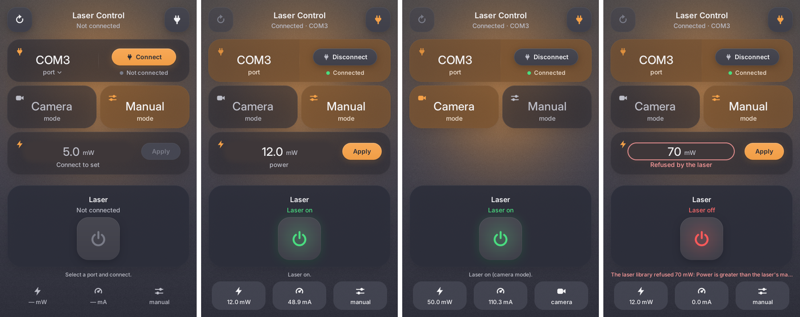

# Laser Control

A small desktop app for driving a lab laser over its serial port. It is written in Python with Tkinter and has a dark, tile-based look. It has two control modes:

- **Manual**: continuous-wave (CW) output at a power you type in.
- **Camera**: pulsed output with external modulation at 50 mW, so a camera's trigger output switches the beam.



> **Laser safety.** This software switches a real laser on and off. Wear eye protection rated for your laser and follow your lab's laser-safety rules. The software is not a safety interlock. Read the [Safety behaviour](#safety-behaviour) section and the [License](#license) disclaimer.

---

## Contents

- [Features](#features)
- [Requirements](#requirements)
- [Quick start (run from source)](#quick-start-run-from-source)
- [Using the app](#using-the-app)
- [Safety behaviour](#safety-behaviour)
- [Settings and logs](#settings-and-logs)
- [Troubleshooting](#troubleshooting)
- [Project layout](#project-layout)
- [Documentation](#documentation)
- [Authors](#authors)
- [License](#license)

---

## Features

- **Connection.** Click the port tile to pick from the serial ports detected on the computer, followed by COM1–COM20. The orange **Connect** button next to it (or the plug button, top right) opens the port; once connected it becomes **Disconnect**, the status line below it reads **● Connected**, and the card turns muted orange.
- **Control mode.** Two tiles:
  - **Manual** shows a **Power** field (mW) with **Apply**. The app sets no power limits of its own.
  - **Camera** shows nothing else and always uses 50 mW.
- **Laser.** A square power button. It is **green when the laser is on**, **red when it is off**, and grey until you connect.
- **Readback.** The bottom bar shows the setpoint (mW), the diode current (mA) and the mode; the latest message sits just above it.
- **Simulator.** `--simulate` runs the whole app against a fake laser, so you can try it without hardware.
- **Settings.** The last port, mode and manual power are remembered between runs.
- **Platforms.** Runs on Windows and macOS, and also works on Linux. It can be packaged as a native app with [Briefcase](https://briefcase.beeware.org) (see [docs/building.md](docs/building.md)).

## Requirements

- Python **3.10 or newer**, with Tkinter. The python.org installers include it. To build apps with Briefcase you need 3.11 or newer.
- [`pyserial`](https://pypi.org/project/pyserial/) and [`Pillow`](https://pypi.org/project/pillow/). They are declared in `pyproject.toml` and installed by the commands below. The laser's serial protocol is implemented in the app itself (`src/laser_app/hardware/laser.py`).

## Quick start (run from source)

Run these from the project folder.

**macOS / Linux**
```bash
python3 -m venv .venv
source .venv/bin/activate
pip install -e .
laser-control --simulate                    # try it with the simulated laser
laser-control                               # with the real laser plugged in
```

**Windows**
```bat
py -m venv .venv
.venv\Scripts\activate
pip install -e .
laser-control --simulate
laser-control
```

`pip install -e .` installs the app in editable mode (code changes take effect without reinstalling) and adds the `laser-control` command. `python -m laser_app` and `python run_laser_control.py` start the same app.

| Option | Meaning |
|---|---|
| `--simulate` | Use a simulated laser. Pick the `SIM` port and connect. |
| `--log-level DEBUG` | Log every command sent to the laser. Other levels are `INFO` (the default), `WARNING` and `ERROR`. |

## Using the app

1. **Connection.** Click the port tile, pick the port, then click **Connect** (or the plug button).
   - On Windows, Device Manager → *Ports (COM & LPT)* shows which COM port the laser uses.
   - On macOS, the port is `/dev/cu.usbserial-…` or `/dev/cu.usbmodem…`.
   - Click the refresh button (top left) after plugging the laser in.
   - The laser always starts with the beam **off**.
2. **Control mode.**
   - **Manual.** Type a power in mW and click **Apply** (or press Enter).
     - Any number is sent; the app sets no limits.
     - Negative values and values above the laser's maximum (read from the laser when connecting) are refused: the field turns red and shows *Refused by the laser*. Nothing is sent and the connection stays open.
   - **Camera.** The app puts the laser in pulsed, externally modulated mode at 50 mW. The camera's trigger output then switches the beam.
3. **Laser.** Click the power button to switch the laser on (green) or off (red). In Camera mode, "on" means *armed*: the beam follows the camera trigger.

## Safety behaviour

The app is built to fail safe:

- The laser is switched **off** when you connect, disconnect, change mode or close the window, and after any communication error.
- "Off" is always **read back** from the laser. If the app cannot confirm it, a red message tells you to switch the laser off at the controller.
- **Turn off** is handled before any other queued command, and it cancels anything still waiting. A queued "turn on" can never run after "turn off".
- If the laser stops answering, the app turns it off as far as it can and disconnects. It does not keep showing stale values.
- Switching back to **Manual** restores your last manual power, never the 50 mW camera power. If that power is outside the laser's limits, the laser's minimum is used instead.
- Closing the window while the laser is on asks for confirmation first.
- If the interlock is open, **Turn on** shows the laser's own refusal message (for example *Interlock open*) and the laser stays off.

## Settings and logs

| | Windows | macOS | Linux |
|---|---|---|---|
| Settings | `%APPDATA%\LaserControl\settings.json` | `~/Library/Application Support/LaserControl/settings.json` | `~/.config/LaserControl/settings.json` |
| Logs | `%APPDATA%\LaserControl\logs\` | `~/Library/Logs/LaserControl/` | `~/.config/LaserControl/logs/` |

Logs rotate at 1 MB and five old files are kept. Delete `settings.json` to reset the app.

## Troubleshooting

| Problem | Fix |
|---|---|
| `No module named '_tkinter'` when running from source | Your Python has no Tkinter. On macOS with Homebrew, run `brew install python-tk@3.X`, using your Python version. Or install Python from python.org and recreate `.venv`. |
| No ports in the list / laser not found | Check the cable and click **Refresh**. On Windows, check Device Manager → *Ports*. On macOS, use the `/dev/cu.*` port. |
| *Refused by the laser* | The power is negative or above the laser's maximum. Nothing was sent. |
| "Could not confirm the laser is off" | The laser stopped answering. **Switch it off at the controller or key switch**, then check the cable and reconnect. |
| Communication error, then disconnected | The cable was unplugged or the laser stopped answering. The app tried to turn the laser off. Reconnect when it's fixed. |
| Problems with the built app (Briefcase) | See [docs/building.md](docs/building.md#troubleshooting). |
| Need more detail | Run with `--log-level DEBUG` and read the log file (see [Settings and logs](#settings-and-logs)). |

## Project layout

```
laser_control/
├── src/laser_app/          the application
│   ├── __main__.py         command line, logging, startup
│   ├── controller.py       worker thread, job queue, safety rules
│   ├── config.py           settings file and log folder
│   ├── hardware/           serial driver, laser procedures, simulator, port list
│   └── ui/                 theme, rendering, layout, widgets and the window
├── tests/                  pytest suite
├── tools/                  build helpers: Tkinter for Briefcase, icon, screenshots
├── resources/              app icon
├── docs/                   architecture, building, development; README screenshot
├── run_laser_control.py    run from source
└── pyproject.toml          Briefcase packaging and pytest settings
```

## Documentation

- [Architecture](docs/architecture.md): threads, safety rules, laser command sequences and how the window is drawn.
- [Building the app](docs/building.md): Briefcase builds for macOS and Windows, packaging and build troubleshooting.
- [Development](docs/development.md): setup, tests, tools and code conventions.
- [Changelog](CHANGELOG.md)

## Authors

- **Author:** Yamandeep Soni ([st195620@stud.uni-stuttgart.de](mailto:st195620@stud.uni-stuttgart.de))
- **Maintainer:** Institut für Photovoltaik (ipv), University of Stuttgart ([ipv@ipv.uni-stuttgart.de](mailto:ipv@ipv.uni-stuttgart.de))

## License

MIT. See [`LICENSE`](LICENSE). Copyright © 2026 Institut für Photovoltaik (ipv), University of Stuttgart.

The software is provided "as is", without warranty of any kind (see `LICENSE`). You are responsible for operating your laser safely.
